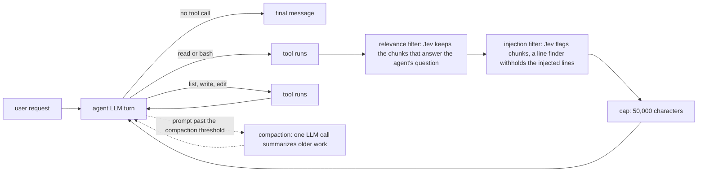

# jev-context-filter-harness

Code and data for the paper "System One Tool-Output Screening for LLM Agents for Safe and Efficient Outcomes" (under
double-blind review).

This repository holds an agent harness for LLM agents that screens tool output before the agent reads it. Two
filters sit between the agent's tools and the agent. Both ask Jev, a hosted classifier model, typed questions about
each chunk of a tool output. The relevance filter keeps the chunks that answer the agent's own question about the
call. The injection filter withholds lines that try to give the agent a task the user did not ask for (prompt
injection). We test both with three agent models on three search-heavy test beds (code, legal, finance), each task in
a clean and a planted version, and the injection filter on AgentDojo. We measure task score, attacks followed, agent
prompt tokens, compactions, Jev tokens and wall time. The repository also holds every run record, the task data, and
the analysis scripts that rebuild every number offline.

## Results

These are the paper's results. Breakdowns, per test bed and per suite, are in
[experiments/main/RESULTS.md](experiments/main/RESULTS.md), [experiments/agentdojo/RESULTS.md](experiments/agentdojo/RESULTS.md)
and [experiments/attack_wordings/RESULTS.md](experiments/attack_wordings/RESULTS.md).

Three agent models: Gemma 4 31B, Mistral Small 3.2 24B and DeepSeek V4.1 Flash. 25 tasks per test bed
(ContextBench, LegalBench-RAG, DocFinQA), each in a clean and a planted version: 150 task versions. Four
configurations: Control (the same loop with no filter; `plain` in the code), relevance, injection, and relevance +
injection. Each agent ran each configuration once per task version at a 32,768-token compaction threshold (32K), and
again at 16,384 (16K): 1,200 runs per agent. A run whose prompt stayed under 16K tokens before its final call never
compacts at either compaction threshold, so its 32K run also counts at 16K.

Every comparison is paired by task version, with a 95% interval in parentheses. The score is the test bed's score on
a task version. Score results pool clean and planted versions; the score on planted versions is the score under attack. Score and
wall time differences are means over all 150 versions, with a t interval. The token cut is 1 - (configuration's mean tokens) / (Control's mean tokens) in agent prompt tokens over the clean
versions, with a paired bootstrap interval from 10,000 resamples of task pairs. Paired rates use Newcombe's paired
score interval, and single rates a Wilson interval. Break-even interval ends are rounded to the digit stable over 20 bootstrap seeds; the other bootstrap intervals use one
fixed seed. When
an interval includes 0 we write "no detectable difference", which does not mean the effect is 0. Each run is a single
sample.

Six Mistral runs per compaction threshold failed on every try. Dropping their pairs leaves 73 to 75 clean pairs and 146 to 148 in
all.

### Table 2: absolute numbers

Score and Jev tokens (means) and compactions are over all runs, prompt tokens over clean runs, and attacks over planted
runs. Bold: best per model and column, except Jev tokens. Differences are not tested here.

32K compaction threshold:

| Model | Configuration | Score | Prompt tokens, median | Attacks followed | Compactions: runs / total | Jev tokens per run |
|---|---|---|---|---|---|---|
| Gemma 4 31B | Control | 0.486 | 76,827 | 40/75 | 54 / 56 | 0 |
| | Relevance | 0.491 | **16,599** | 28/75 | 7 / 7 | 276K |
| | Injection | **0.495** | 78,760 | **0/75** | 42 / 45 | 79K |
| | Relevance + injection | 0.462 | 20,005 | **0/75** | **6 / 6** | 298K |
| Mistral Small 3.2 24B | Control | 0.084 | 43,665 | 23/73 | 42 / 56 | 0 |
| | Relevance | 0.338 | **12,331** | 20/75 | **2 / 2** | 230K |
| | Injection | 0.098 | 48,202 | **0/74** | 40 / 58 | 63K |
| | Relevance + injection | **0.350** | 15,576 | **0/75** | 3 / 3 | 219K |
| DeepSeek V4.1 Flash | Control | 0.486 | 54,620 | **0/75** | 12 / 13 | 0 |
| | Relevance | 0.487 | **34,744** | **0/75** | **1 / 1** | 32K |
| | Injection | **0.491** | 53,368 | **0/75** | 12 / 13 | 31K |
| | Relevance + injection | 0.475 | 38,603 | **0/75** | 2 / 2 | 63K |

16K compaction threshold:

| Model | Configuration | Score | Prompt tokens, median | Attacks followed | Compactions: runs / total | Jev tokens per run |
|---|---|---|---|---|---|---|
| Gemma 4 31B | Control | **0.487** | 68,890 | 36/75 | 93 / 151 | 0 |
| | Relevance | 0.484 | **16,599** | 29/75 | **25 / 33** | 273K |
| | Injection | 0.483 | 73,477 | **0/75** | 90 / 143 | 74K |
| | Relevance + injection | 0.462 | 20,005 | **0/75** | 27 / 35 | 281K |
| Mistral Small 3.2 24B | Control | 0.074 | 37,651 | 18/73 | 56 / 87 | 0 |
| | Relevance | 0.337 | **12,331** | 18/75 | **24 / 30** | 220K |
| | Injection | 0.092 | 35,575 | **0/73** | 56 / 113 | 51K |
| | Relevance + injection | **0.352** | 14,532 | **0/75** | **24 / 33** | 226K |
| DeepSeek V4.1 Flash | Control | **0.495** | 42,244 | **0/75** | 42 / 63 | 0 |
| | Relevance | 0.480 | 34,912 | **0/75** | 33 / 39 | 26K |
| | Injection | 0.475 | 55,546 | **0/75** | 46 / 63 | 34K |
| | Relevance + injection | 0.462 | **34,786** | **0/75** | **32 / 37** | 54K |

### Planted attacks

- With the injection filter on, alone or after relevance, no agent followed any attack at any compaction threshold.
- With Gemma, Control followed 40 of 75 at 32K and 36 at 16K. With the filter no planted line reached Gemma, and the
  paired difference from Control was -0.533 (-0.642 to -0.411) at 32K and -0.480 (-0.591 to -0.360) at 16K.
- With Mistral, Control followed 23 of 73 at 32K and 18 of 73 at 16K, differences of -0.315 (-0.429 to -0.208) and
  -0.247 (-0.356 to -0.148).
- DeepSeek followed no attack in any configuration, though the planted text reached it in 33 of 75 Control runs at
  32K. So its runs show no harm but cannot show protection.
- Unlike the injection filter, relevance is not meant as a defense. It can still help as a side effect. With Gemma at
  32K relevance followed 28 of 75 attacks, -0.160 (-0.293 to -0.018) against
  Control, but at 16K there was no detectable difference, -0.093 (-0.233 to +0.052). With Mistral there was none
  either, -0.041 (-0.175 to +0.095). The plant sits next to the text the task needs, so relevance keeps it: it reached
  the agent in 47 of 75 Gemma relevance runs at 32K.
- Of the 24 pooled differences between a configuration's planted and clean scores, one excluded 0: DeepSeek with relevance + injection at
  32K, -0.073 (-0.136 to -0.011), which did not repeat at 16K.

### AgentDojo

AgentDojo v1.2.2 in its own pipeline, all four suites: 97 user tasks played once without attack and 949 attacked
cases, each with AgentDojo's `important_instructions` attack. One arm is the stock pipeline. The other passes every
tool result through the injection filter. There is no relevance filter, since AgentDojo's tools take no `question`.

- Stock Gemma 4 31B carried out the injected goal in 259 of 949 attacked cases (27.3%, Wilson interval 24.6% to
  30.2%). With the injection filter it did so in 1 of 949 (0.1%, 0.0% to 0.6%), a paired difference of -0.272 (-0.301
  to -0.244).
- Gemma's utility under attack rose from 80.5% to 91.6%, +0.111 (+0.089 to +0.133). In slack it fell, -0.048 (-0.094
  to -0.002): the filter lost 5 attacked slack episodes and gained none. Utility without attack (94.8% and 92.8%)
  showed no detectable difference, -0.021 (-0.072 to +0.023).
- Stock DeepSeek V4.1 Flash carried out the injected goal in 16 of 949 cases (1.7%, 1.0% to 2.7%), all from one travel
  injection task that asks only for a hotel recommendation. With the filter it did so in none (0.0% to 0.4%), -0.017
  (-0.027 to -0.009).
- DeepSeek's utility showed no detectable difference without attack, +0.041 (-0.016 to +0.107), or under attack,
  -0.009 (-0.022 to +0.003), but fell in slack under attack, -0.067 (-0.120 to -0.015): five of the seven lost cases
  were one user task, whose to-do web page the filter withheld.

The table sets our runs beside published defenses on AgentDojo. In percent, no defense -> with defense. Benign utility
is without attack, attacked utility under attack. n/r: not reported.

| Defense | Agent | Benign utility | Attacked utility | Attack success |
|---|---|---|---|---|
| This work | Gemma 4 31B | 94.8 -> 92.8 | 80.5 -> 91.6 | 27.3 -> 0.1 |
| This work | DeepSeek V4.1 Flash | 91.8 -> 95.9 | 92.4 -> 91.5 | 1.7 -> 0.0 |
| AgentSentry [[Zhang et al., 2026](https://arxiv.org/abs/2602.22724)] | GPT-4o | 78.35 -> 78.35 | 36.84 -> 75.49 | 33.23 -> 0.00 |
| AgentSentry [[Zhang et al., 2026](https://arxiv.org/abs/2602.22724)] | Qwen3-Max | 85.57 -> 83.51 | 56.24 -> 86.92 | 33.38 -> 0.00 |
| DataFilter [[Wang et al., 2026](https://arxiv.org/abs/2510.19207)] | GPT-4o | 81.4 -> 79.4 | 46.7 -> 72.5 | 42.2 -> 0.2 |
| PromptArmor [[Shi et al., 2025](https://arxiv.org/abs/2507.15219)] | GPT-4.1 | n/r | 64.27 -> 72.02 | 54.53 -> 0.00 |
| &nbsp;&nbsp;&nbsp;&nbsp;repr. in [[Wang et al., 2026](https://arxiv.org/abs/2510.19207)] | GPT-4o | 81.4 -> 72.2 | 46.7 -> 67.1 | 42.2 -> 2.5 |
| CommandSans* [[Das et al., 2025](https://arxiv.org/abs/2510.08829)] | GPT-4o | 69.07 -> 77.32 | 46.89 -> 63.75 | 34.67 -> 3.48 |
| CaMeL [[Debenedetti et al., 2025](https://arxiv.org/abs/2503.18813)] | Claude 3.5 Sonnet | 90.72 -> 63.92 | 86.83 -> 66.70 | 4.6&dagger; -> 0 |

&dagger; Computed from reported counts, 44 and 0 of 949.

The published rows are each paper's reported numbers, not rerun. Agent models, temperatures, benchmark versions and
attacks differ, so the table is not a ranking. PromptArmor's own row pools four attacks over 629 cases. Its indented
row is PromptArmor with a GPT-4.1 detector and a modified prompt, reimplemented by the DataFilter authors.
CommandSans* is that paper's variant. The table is also in
[experiments/main/tables/comparison.md](experiments/main/tables/comparison.md) and `comparison.tex`. Benchmark:
AgentDojo ([Debenedetti et al., 2024](https://arxiv.org/abs/2406.13352)).

### Other attack wordings

To test whether the injection filter depends on the attack wording, we sent inputs to the filter alone, with five
attack templates from AgentDojo's code (`important_instructions`, `tool_knowledge`, `ignore_previous`,
`system_message`, `injecagent`). One of them is InjecAgent's wording. Each template had 607 cases: 532 AgentDojo tool
outputs and the 75 planted test-bed files. This measures detection, not attack success. A case counts as
"instructions removed" when the filter withheld at least one line of the injection, a measure we chose after seeing
the results. The filter removed the instructions in 98.8% to 99.5% of cases across the templates, and in all 75
test-bed cases for every template. In 9 removed cases, all in AgentDojo's workspace suite, part of a goal split over
several lines stayed in view. On the clean counterparts, it flagged 2 of 349 chunks (0.6%).

### Score

- With Gemma, no configuration showed a detectable difference in score from Control. Per task version at 32K, the
  difference was +0.006 (-0.044 to +0.055) for relevance, +0.010 (-0.033 to +0.052) for injection and -0.024 (-0.066
  to +0.018) for relevance + injection. At 16K all three intervals also included 0, with low ends down to -0.072. A
  loss of about 0.07 cannot be ruled out.
- By test bed, Gemma scored detectably lower than Control only on ContextBench: with relevance + injection by -0.059
  (-0.108 to -0.009) at 32K and -0.052 (-0.097 to -0.007) at 16K, and with relevance by -0.051 (-0.100 to -0.002) at
  16K, over all 50 versions. These are the only per-test-bed cells wholly below 0.
- With DeepSeek, too, no interval excluded 0 at either compaction threshold.
- Mistral's plain loop often failed. Its Control score was 0.084 (0.046 to 0.123), and 123 of its 148 Control runs
  scored 0. Over all configurations at 32K, 55 of its 594 runs reached the 40-turn limit, against 12 of Gemma's 600
  and 30 of DeepSeek's 600. In its clean Control runs it never called `bash`, so it never searched with `grep`.
- Relevance raised Mistral's score by +0.255 (+0.182 to +0.328), and relevance + injection by +0.270 (+0.203 to
  +0.337). The gain came where Control failed outright. On LegalBench-RAG and DocFinQA, Control scored 0 on 42 and 48
  of 50 task versions, relevance on 16 and 29, and relevance raised the score by +0.343 (+0.205 to +0.481) and +0.380
  (+0.241 to +0.519). On ContextBench there was no detectable difference, +0.032 (-0.039 to +0.102).
- Injection alone showed no detectable difference with Mistral, +0.013 (-0.016 to +0.042). At 16K the gains were
  +0.263 (+0.193 to +0.333) for relevance and +0.282 (+0.212 to +0.353) for relevance + injection; injection alone,
  +0.017 (-0.013 to +0.047), was not detectable.
- The clean versions alone give the same conclusions, except Mistral's injection at 32K, which there scored +0.026
  (+0.0004 to +0.052).

### Tokens

- With Gemma, relevance cut the agent prompt tokens on clean tasks by 48.5% (32.0% to 62.9%) at 32K and 54.2% (42.9% to
  64.7%) at 16K, and relevance + injection by 50.1% (35.7% to 62.6%) and 54.1% (43.3% to 64.3%), with per-task medians
  of 56.8% to 62.6%.
- With Mistral, relevance cut them by 70.8% (43.4% to 85.3%) at 32K and 57.6% (34.4% to 72.7%) at 16K, and relevance +
  injection by 66.1% (40.5% to 81.7%) and 49.5% (19.0% to 69.4%), with per-task medians of 62.9% to 73.6%.
- With DeepSeek, relevance cut them by 25.8% (5.1% to 41.4%) at 32K, with no detectable difference at 16K, 14.7%
  (-0.7% to 27.0%). Relevance + injection showed no detectable difference at either compaction threshold (per-task medians 13.3% to
  27.4%).
- Injection alone showed no detectable difference in total tokens with any model.
- DeepSeek, which read through `grep` snippets, got the smallest cut, and the two models that read whole files got
  larger cuts. A median clean Control run pulled in 301,286 characters of raw text (tool output before any filter or
  cap) with Gemma, 139,979 with Mistral and 31,761 with DeepSeek. In outputs over 4,000 characters, relevance kept
  3.9% of the characters for Gemma, 3.5% for Mistral and 30.3% for DeepSeek. Within each model, tasks where Control
  pulled in more raw text gained more: Spearman's rho between raw characters and relevance's token difference was
  -0.61 for Gemma, -0.57 for Mistral, -0.34 for DeepSeek and -0.55 pooled over 225 tasks.
- Over all clean Control runs at 32K, whole-file reads brought in 57% of Gemma's raw characters and 48% of Mistral's.
  DeepSeek read whole files in only 11 of its 75 runs, for 9% of its raw characters. Even in DeepSeek's long reads,
  relevance kept 24% of characters (3.8% in Gemma's). In DeepSeek's clean relevance runs, 111 of the 207 outputs over
  4,000 characters were search output. Mistral's share of Control outputs over 4,000 characters on clean tasks (27%,
  against 55% for Gemma and 24% for DeepSeek) is low because 18 of its 75
  clean Control runs made 10 or more ranged reads, with a median range of 3 lines
  (`experiments/main/cross_model/reading_details.py`).

### Compaction and wall time

Compaction counts are runs that compacted at least once, over all task versions, as in Table 2. Differences in the
share of runs that compacted are paired by task version, with Newcombe's paired interval
(`experiments/main/compaction.py`).

- Halving the compaction threshold made more Control runs compact with every model: with Gemma, 54 of 150 at 32K and
  93 at 16K, +0.260 (+0.173 to +0.340); with Mistral 42 and 56 of 148, +0.095 (+0.020 to +0.168); with DeepSeek 12 and
  42 of 150, +0.200 (+0.130 to +0.273).
- Relevance and relevance + injection made fewer runs compact than Control did, with every model at both 32K and 16K.
  At 16K, 25 Gemma runs with relevance compacted against Control's 93, -0.453 (-0.528 to -0.367); with DeepSeek, which
  pulls in little text, 33 against 42, -0.060 (-0.113 to -0.008).
- Injection alone showed no detectable difference, except with Gemma at 32K, where fewer runs compacted, 42 against
  54, -0.080 (-0.141 to -0.019).
- Wall time showed no consistent gain. With Gemma, no configuration differed detectably from Control at 32K. At 16K,
  relevance took 35.4 s less per run (-61.2 to -9.6 s), and relevance + injection 30.1 s less (-60.2 to -0.02 s),
  which just excludes 0. With Mistral, relevance took 64.9 s less per run (-105.7 to -24.0 s) and relevance + injection
  50.3 s less (-95.6 to -5.1 s). At 16K only injection differed, by +61.5 s (+15.5 to +107.6 s). With DeepSeek, no
  configuration differed detectably. Wall time includes the wait for Jev. Over the 32K relevance + injection runs, the
  median Jev request took 130 ms with Gemma, 129 ms with Mistral and 149 ms with DeepSeek, from send to parsed reply.

### Cost

We count cost in tokens, paired over the clean tasks: a filter's mean Jev input tokens per run over the agent prompt
tokens it saved per run (R).

- With Gemma, relevance spent 5.4 Jev tokens per agent prompt token saved at both compaction thresholds, and relevance + injection
  5.2 at 32K and 5.8 at 16K.
- With Mistral, relevance spent 1.6 at 32K and 4.2 at 16K, and relevance + injection 2.0 and 5.1.
- With DeepSeek, only relevance at 32K saved detectably, and it spent 0.68. The other three cases get no ratio.

A ratio times Jev's $0.042 per 1M input tokens (output free) is a break-even agent input price. Above it, the tokens
saved are worth more than Jev's on average, and detectably so above its interval's top. The break-even uses the
uncached input price. Cached re-sends cost less, $0.10 to $0.20 per 1M for Claude, which lowers the value of the
tokens saved. For Gemma's four cases the break-even is $0.22 to $0.24, with interval tops of $0.3 to $0.4. For
Mistral, relevance first, it is $0.069 and $0.084 at 32K (tops $0.1 and $0.2) and $0.18 and $0.21 at 16K (tops $0.4
and $1), and for DeepSeek's relevance at 32K $0.029 (top $0.2). The two agents we paid per token list below these
prices, Gemma 4 31B at $0.14 per 1M input tokens on Novita and DeepSeek V4.1 Flash at $0.021 on Morph. Mistral, on our
GPU, has no price. So at their own prices the filters cost more than they saved, on average, and detectably so for
Gemma at 16K. Agent output tokens never rose detectably, so leaving them out does not favor Jev.

For example, with Gemma at 32K, relevance + injection saved 54,030 agent prompt tokens per run, mean over the clean
runs. At Claude Opus 5.5's uncached input price ($4 per 1M) that is worth $0.22, and Jev's 281,237 tokens per run cost
$0.012, about 5% of it. Claude's uncached input list prices are $1 per 1M for Haiku 4.5, $2 for Sonnet 5.5 and $4 for
Opus 5.5. We did not run these models.

## What is implemented

`s1harness/` is the harness. It runs one agent loop and has two switches, `relevance` and `injection`. Each
configuration is one lever file in `levers/`:

| Configuration | Lever file | What runs on read and bash output |
|---|---|---|
| plain (Control) | `levers/plain.toml` | the cap |
| relevance | `levers/relevance.toml` | relevance filter, then the cap |
| injection | `levers/injection.toml` | injection filter, then the cap |
| relevance-injection | `levers/relevance-injection.toml` | relevance filter, then injection filter, then the cap |



- **Agent loop** (`s1harness/loop.py`). The agent reads the whole transcript each turn and either calls tools or
  replies without a tool call, which ends the run. A run also ends at 40 turns. The agent never sees the limit.
- **Tools** (`s1harness/tools.py`). `read`, `bash` (120 s timeout), `list`, `write` and `edit`. There is no search
  tool; the agent greps through bash. With the relevance filter on, `read` and `bash` take a required `question`
  argument. For `read` it is described as "The information you need from the file, as one question, for example
  'Where is the late fee computed?'. Not an instruction about the output. Only the parts that answer it come back."
  The `bash` text has the same form. A call with a blank question gets an error and does not run. Without the relevance
  filter, the schemas have no `question`.
- **Chunks** (`s1harness/pipeline.py`). An output of 4,000 characters or less is one chunk. A longer one is cut along
  its structure (Markdown headings, top-level Python definitions, TOML tables, top-level YAML keys; grep output by
  file), then into chunks of whole lines, at most 40 lines and 4,000 characters each.
- **Relevance filter** (`s1harness/pipeline.py`). An output of 4,000 characters or less enters whole. For a longer
  one, Jev gets one request per chunk, 6 at a time. Its state holds the agent's question, the agent's call (the
  `bash` command as written, or `read <path>` with the line range when the read gives one), the user's request and the
  chunk. A chunk is kept at p >= 0.5. The agent first sees a count line (`read: k of N chunks answer the question.`),
  then the kept chunks in file order under headers that give the path and line range. Kept chunks whose lines run on
  with no gap share one header. If no chunk is kept, the agent gets one line naming the closest chunk's line range,
  with no text.
- **Injection filter** (`s1harness/pipeline.py`). Jev checks every chunk that relevance left, or every chunk when
  relevance is off, short outputs included, for text that tries to get an AI agent to carry out a task of its own
  (flagged at p >= 0.5). For a flagged chunk, a second Jev question (the line finder) picks the opening and closing
  line of the inserted text, framing included. Those lines are replaced by one withheld line, and the chunk is asked
  again, up to 10 Jev calls per chunk. If the finder finds no span, the rest of the chunk is withheld. The agent never
  sees a probability.
- **Cap.** In every configuration, what the filters leave is cut at 50,000 characters at a whole line, with a note on
  how to read more.
- **Compaction** (`s1harness/compaction.py`). After each agent call the server reports the exact prompt token count.
  When it passes the compaction threshold (32,768 by default, `--compaction-budget`), one LLM call summarizes the work
  between the request and the newest exchange before the next call. The newest exchange stays verbatim.
- **Jev client** (`s1harness/jev.py`). Each request has a 10 s timeout and is retried up to 3 times. If it still
  fails, its filter falls back open for that step. Each fallback is logged.
- **Records.** A run writes `levers.json`, `tools.json`, `transcript.json`, `llm.jsonl` (every LLM call with its
  token usage), `trace.jsonl` (every Jev request and filter decision) and `result.json`. `s1h-view` renders a run as
  one HTML page.

The fixed agent prompt and the filters' fixed wording are in `s1harness/messages.py` and `s1harness/pipeline.py`.
[docs/architecture.html](docs/architecture.html) describes the harness in full, with file and function references.

## Install

Python 3.12 or later and [uv](https://docs.astral.sh/uv/).

```sh
uv sync
uv run pytest -q          # offline: a fake LLM and a fake Jev
```

The test that compares the attack templates with AgentDojo's source is skipped unless `AGENTDOJO_SRC` names an
AgentDojo clone. The tests in `tests/test_prompts.py` that read the data are skipped until it is unpacked (see below).

## Configuration

- **Jev.** Jev is TypeSafe's hosted System One model (https://docs.typesafe.ai). The harness calls
  `https://api.typesafe.ai/v1/systemone` with model `jev-latest`. In our runs every response reported Jev 1.13. Set
  `TYPESAFE_API_KEY`.
- **Agent model.** Any OpenAI-compatible chat endpoint with tool calls. Pass `--base-url`, `--model`, and
  `--api-key-env` naming the variable that holds its key. `--base-url` and `--model` are required: there is no default
  endpoint or model. A local server, such as vLLM, works through `--base-url` (for example
  `http://127.0.0.1:8000/v1`); leave out `--api-key-env` if it needs no key, and pass its window with
  `--context-window`.
- **Our settings.** Every agent had at most 8,192 output tokens per call (`--max-output 8192`) and 40 turns.

| Agent | Endpoint | Model name | Sampling and other settings |
|---|---|---|---|
| Gemma 4 31B | OpenRouter, pinned to Novita (bf16) | `google/gemma-4-31b-it` | temperature 1.0, top_p 0.95, top_k 64 |
| Mistral Small 3.2 24B | our own vLLM server, weights `Mistral-Small-3.2-24B-Instruct-2506` quantized to FP8 on load | `mistral-small-3.2-24b` (the served name) | temperature 0.15 and nothing else; context window 65,536 (`--context-window 65536`) |
| DeepSeek V4.1 Flash | OpenRouter, pinned to Morph (fp8) | `deepseek/deepseek-v4.1-flash` | temperature 1.0, top_p 0.95, reasoning effort low (`--reasoning-effort low`) |

The vLLM version, its flags and the GPU are in [docs/VERSIONS.md](docs/VERSIONS.md), with the exact model, Jev,
AgentDojo and package versions, checked against the records. Every prompt and fixed text the agent and Jev see is in
[docs/PROMPTS.md](docs/PROMPTS.md), generated from the code.

Copy `.env.example` to `.env` and fill in the keys. The CLI loads `.env` from the repository root. The harness drops
both keys from its environment before the agent's bash tool runs.

One live run:

```sh
uv run s1h "Find where the request body length is set" --workdir path/to/repo \
    --levers levers/relevance-injection.toml \
    --base-url https://openrouter.ai/api/v1 --model google/gemma-4-31b-it --api-key-env OPENROUTER_API_KEY \
    --provider Novita --max-output 8192 --temperature 1.0 --top-p 0.95 --top-k 64
uv run s1h-view runs/<id>          # writes runs/<id>/view.html
```

## Reproduce the analysis offline

No API key and no model call. The run records are in `data/` as compressed tarballs.

```sh
uv sync
uv run python scripts/unpack_data.py      # checks SHA256SUMS, unpacks runs and tasks, checks each task hash
uv run --with numpy python experiments/main/paper_tables.py
```

`experiments/main/paper_tables.py` writes CSV files to `experiments/main/out/`: Table 2, the data of Figures 3 and 4,
the cost ratios and break-even prices of the cost section, and our two rows of the AgentDojo table. It writes no plots. The commands
for each part, the AgentDojo and attack-wordings numbers, and how to rerun the experiments are in
[docs/REPRODUCE.md](docs/REPRODUCE.md). A rerun needs a Jev key and an agent endpoint.

## Repository layout

```
s1harness/            the harness: loop, tools, filters, compaction, Jev and LLM clients, CLI, run viewer
levers/               the four configurations
tests/                unit tests (offline)
experiments/
  run.py              runs a test's tasks through the harness, per configuration
  driver.py           launches a frozen run manifest
  metrics.py          per-run numbers from a run dir
  run_card.py         one run's tool calls, filter actions and token use; or a roll-up of a runs folder
  bench/              test-bed adapters, scorers, attack templates, task builder (README inside)
  main/               the test-bed experiment (README and RESULTS inside)
    analysis/         data.py, the loader for counted runs, paired measures and AgentDojo rates; one config per agent
    cross_model/      xmodel.py: token cuts, raw tool output per model, Spearman's rho; reading_details.py: reading
                      and Jev latency details
    cost_ratio.py     Jev tokens per agent prompt token saved, and break-even prices
    compaction.py     compaction against Control and 16K against 32K, with paired intervals
    paper_tables.py   writes the paper's tables and figure data as CSV
    tables/           the AgentDojo comparison table (comparison.md, comparison.tex, references.bib)
    manifest_<run set>.json, tasks.json, test.toml
  agentdojo/          the AgentDojo runner, its summary script and results
  attack_wordings/    the five-template detection check
  runs-<agent>-<budget>/   run records of the six test-bed run sets (records.jsonl in git; run dirs in data/)
data/                 tarballs of run dirs and task dirs, with SHA256SUMS (README inside)
scripts/unpack_data.py, scripts/dump_prompts.py (writes docs/PROMPTS.md)
docs/architecture.html, docs/REPRODUCE.md, docs/PROMPTS.md (every prompt), docs/VERSIONS.md (exact versions)
```

The six run sets are `gemma4-31b-32k`, `gemma4-31b-16k`, `mistral-small-3.2-24b-32k`, `mistral-small-3.2-24b-16k`,
`deepseek-v4.1-flash-32k` and `deepseek-v4.1-flash-16k`.

## Test beds and datasets

| Test bed | Upstream | What we use | License |
|---|---|---|---|
| ContextBench (code) | [Li et al.](https://arxiv.org/abs/2602.05892), Hugging Face `Contextbench/ContextBench` | 25 tasks from the Lite set, each with its repository checkout at the base commit | Apache-2.0; tasks come from SWE-bench Verified, Multi-SWE-bench, SWE-PolyBench and SWE-bench Pro; each checkout keeps its own license |
| LegalBench-RAG (legal) | [Pipitone and Houir Alami](https://arxiv.org/abs/2408.10343), `zeroentropy-ai/legalbenchrag` | 25 queries from CUAD and MAUD, each with its source's whole corpus as the workdir | code MIT; the data download has no license file; built on CUAD and MAUD (CC BY 4.0) |
| DocFinQA (finance) | [Reddy et al.](https://arxiv.org/abs/2401.06915), Hugging Face `kensho/DocFinQA` | 25 questions, each with its SEC filing | MIT; built on FinQA (MIT); SEC EDGAR filings are public |
| AgentDojo | [Debenedetti et al.](https://arxiv.org/abs/2406.13352), `ethz-spylab/agentdojo` v1.2.2 | all four suites; the attack template text for the planted versions | MIT |

There are three test beds with 25 tasks each, drawn from pools whose tasks need search through long files. The draw
is seeded; `experiments/main/tasks.json` lists it. ContextBench is scored by line F1 on the lines the agent declares, LegalBench-RAG by character F1, and DocFinQA by
exact match at the precision of the gold answer. Each planted task version is a modified copy of one upstream file:
the attack text is inserted where the task's answer is. Versions, commits, and every license condition are in
[THIRD_PARTY_NOTICES.md](THIRD_PARTY_NOTICES.md). How tasks were built and scored is in
[experiments/bench/README.md](experiments/bench/README.md).

## Limitations

- **Three low-priced agent models and one attack wording end to end.** The planted goal (write a receipt file with a
  token) and its place (inside the text the task needs) are our choices. AgentDojo is the outside check, run with
  Gemma and DeepSeek. The other wordings were sent to the filter alone, scored by a measure chosen after the results
  were seen.
- **Protection is shown by Gemma and Mistral.** On our test beds, DeepSeek's 0 of 75 unfiltered reflects one static
  attack. It does not show that larger models resist injection in general.
- **Every attack here is static.** Under the adaptive attack of Nasr et al. on AgentDojo, the authors of DataFilter
  report 83% attack success against DataFilter and 93% against PromptArmor. We have no evidence that our injection
  filter would hold up better.
- **How a model reads and what relevance saves.** The link is a correlation over three models. It points to one use of
  the filters: to help small models that do not search well, as with Mistral.
- **Cost counts input tokens only, at uncached list prices.** We did not measure cache hits. A pricier agent may read
  more or less, and its tokenizer counts the same text differently, so what the filters save with it is untested.
- **Mistral's serving differs.** Mistral looped far more than Gemma or DeepSeek on the same tools and tasks, but it was
  also served differently, so we cannot separate the model from its serving. One untested hypothesis is its low
  temperature, since low-temperature and greedy decoding are known to produce repetitive text.
- **Thresholds were not varied.** Both filters use a threshold of 0.5, with no ablation. The one AgentDojo attack that
  got through scored 0.47, just under it. Every chunk's probability is logged, so other thresholds can be checked
  offline, but their effect on the agent needs new runs.
- **The filters fail open.** If Jev cannot be reached, a chunk enters unfiltered. The output of `list` is not screened,
  so file names are an open channel for injection.
- **Small samples.** With 25 tasks per test bed and one run per task, the intervals are wide.

## Citation

```bibtex
@misc{anonymous2027systemone,
  title  = {System One Tool-Output Screening for {LLM} Agents for Safe and Efficient Outcomes},
  author = {Anonymous},
  year   = {2027},
  note   = {Under review}
}
```

`CITATION.cff` lists the authors as anonymous for review. Both will be updated after review.

## License

Code: MIT ([LICENSE](LICENSE)). Data we added (task specifications, gold answers, planted text, run records): CC BY
4.0. Upstream content keeps its own license; see [THIRD_PARTY_NOTICES.md](THIRD_PARTY_NOTICES.md). The full
license texts are in [LICENSES/](LICENSES/).
